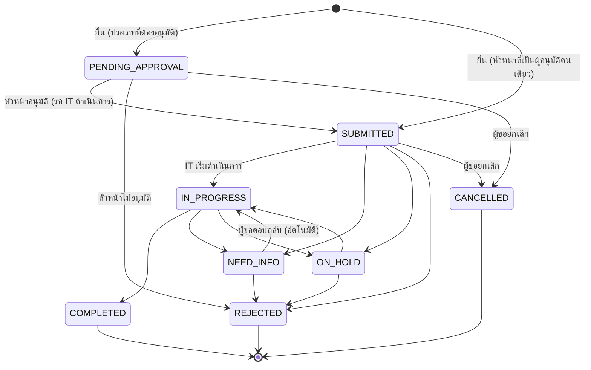
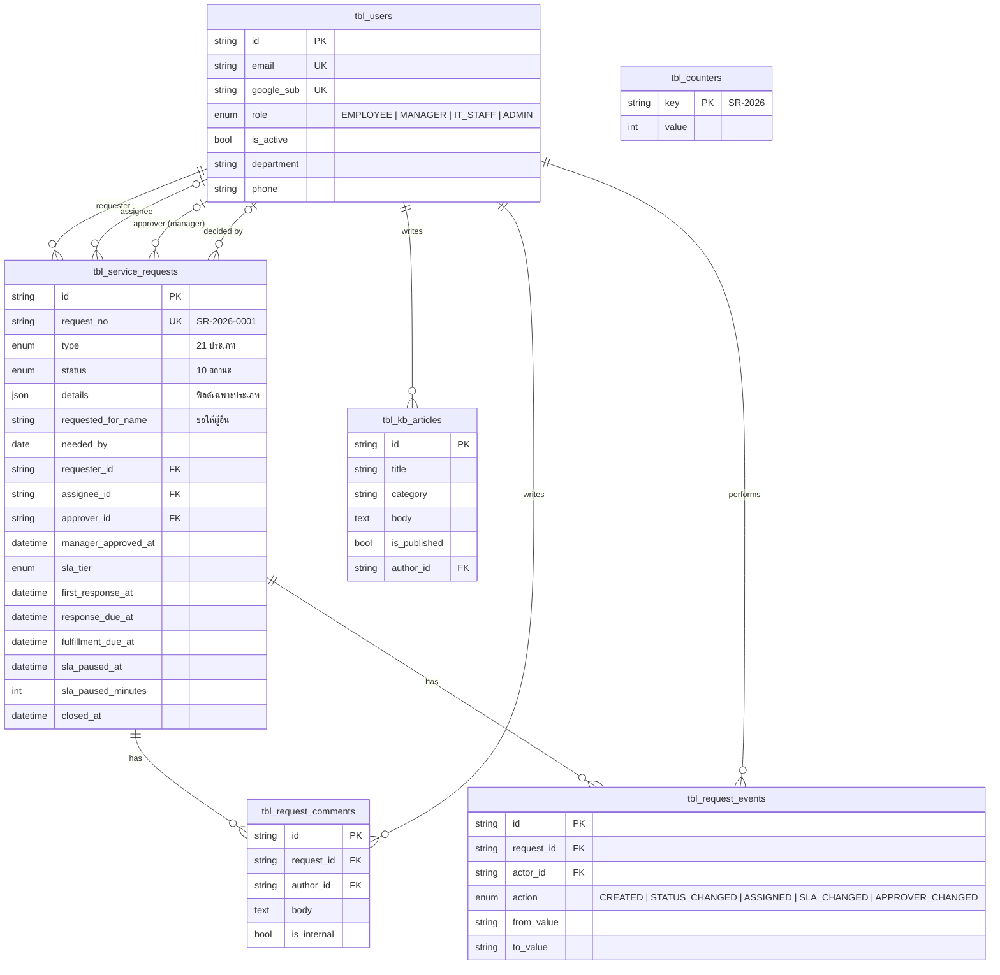

# AIDC Service Request

ระบบยื่นคำขอบริการด้าน IT สำหรับพนักงาน AIDC Tech: ขอเบิกอุปกรณ์ ติดตั้งซอฟต์แวร์ ขอสิทธิ์/บัญชีผู้ใช้ ขอคำปรึกษา และทรัพยากร Cloud พร้อมหัวหน้างานอนุมัติทุกคำขอก่อนถึงทีม IT, SLA ที่นับตามเวลาทำการ และฐานความรู้ให้พนักงานค้นหาวิธีแก้ปัญหาเบื้องต้น

**Stack:** Next.js 16 (App Router) · TypeScript · Tailwind CSS 4 · Prisma 6 · PostgreSQL (`service-request_db`) · Google Workspace SSO

## ขอบเขต

ระบบนี้รองรับ **Service Request** คือคำขอที่วางแผนล่วงหน้าได้ ไม่ได้เกิดจากอุปกรณ์หรือระบบเสีย **ฟอร์มแจ้งปัญหาขัดข้อง (Incident) ยังไม่รวมในรอบนี้** หน้าแรกจึงแสดงการ์ด Incident เป็น "เร็วๆ นี้" และแนะนำให้แจ้งทีม IT ตามช่องทางเดิม (ตาราง Priority P1–P4 และ SLA ของ Incident ที่ได้รับมาเก็บไว้สำหรับรอบถัดไป)

## ภาษา (ลาว / ไทย / English)

หน้าจอรองรับ 3 ภาษา **ภาษาหลักคือลาว (ລາວ)** มีปุ่มสลับ **ລາວ / ไทย / ENG** ที่ Sidebar (บนมือถืออยู่ในเมนู) และที่หน้า Login การเลือกเก็บใน cookie `lang` (อายุ 1 ปี) ใช้ได้ก่อนเข้าสู่ระบบ ผู้ใช้ใหม่เริ่มที่ภาษาลาว

- **ข้อความหน้าจอ:** เขียนด้วย `t("ไทย", "ລາວ", "English")` (ไทยก่อน ลาวตามด้วยอังกฤษ) ฝั่ง server ใช้ `const t = await getT()` จาก `@/lib/i18n-server` ฝั่ง client ใช้ `const t = useT()` จาก `@/components/lang-provider` ข้อมูลระดับ module (ป้ายสถานะ, ประเภทคำขอ, ตัวเลือกในฟอร์ม) ใช้ `l(th, lo, en)` แล้วแสดงด้วย `t(ค่านั้น)` (นิยามที่ [`src/lib/i18n.ts`](src/lib/i18n.ts))
- **วันที่และตัวเลข:** `formatDate(x, lang)` ฯลฯ ใน [`src/lib/labels.ts`](src/lib/labels.ts) ภาษาไทยแสดงปี พ.ศ. ส่วนลาวและอังกฤษแสดงปี ค.ศ. เขตเวลาเดียวกันทุกภาษา
- **ฟอนต์:** IBM Plex (ละติน/ไทย) คู่กับ Noto Sans Lao (ลาว) เบราว์เซอร์เลือกฟอนต์ตามอักษรแต่ละตัว
- **ตัวตรวจ:** `npm test` รวมเทสต์ [`src/lib/i18n.test.ts`](src/lib/i18n.test.ts) ที่สแกนโค้ดทั้งหมดและจะไม่ผ่านถ้ามีข้อความไทย/ลาวนอก `t()`/`l()`, ช่องภาษาปะปนกัน (เช่น ไทยหลุดไปในช่องลาว), ขาดภาษาใดภาษาหนึ่ง หรือใช้ `"th-TH"` ตรงๆ แทน `INTL_LOCALE`
- **ข้อมูลที่ผู้ใช้พิมพ์เอง** (หัวข้อคำขอ ข้อความ บทความในฐานความรู้) ไม่ถูกแปล แสดงตามที่เขียนไว้ ข้อมูลตัวอย่างจาก `npm run db:seed` เขียนเป็นภาษาลาว
- **ควรให้เจ้าของภาษาลาวตรวจคำแปล** ก่อนใช้งานจริง โดยเฉพาะข้อความทางการและศัพท์เทคนิค คำแปลทั้งหมดอยู่ในโค้ดที่เรียก `t()`/`l()` (ค้นหาได้ง่ายด้วย grep)

## ประเภทคำขอ

ฟิลด์ทั้งหมดกำหนดที่เดียวใน [`src/lib/request-types.ts`](src/lib/request-types.ts) ใช้ทั้งสร้างฟอร์ม (ช่องที่แสดงเปลี่ยนตามคำตอบ) และตรวจข้อมูลฝั่ง server

มี 21 ประเภท แบ่งเป็น 9 หมวด และแต่ละหมวดติดป้ายว่าเป็นของ **ลูกค้า / ผู้ใช้งานระบบ**, **ทีมงานภายใน** หรือทั้งสองกลุ่ม หน้า "สร้างคำขอใหม่" จัดกลุ่มตามหมวด มีแท็บกรอง ทั้งหมด / ลูกค้า / ทีมงานภายใน และช่องค้นหา (กลุ่มของแต่ละหมวดกำหนดที่ `audience` ใน `REQUEST_CATEGORIES`) และมีข้อความบอกว่า Change Request (เพิ่ม/ลด/แก้ไขฟังก์ชันซอฟต์แวร์ ต้องประเมิน Manday / งบประมาณ) ไม่ใช่คำขอบริการ

| หมวด (กลุ่ม) | ประเภท | ระดับ SLA เริ่มต้น |
| --- | --- | --- |
| Access & Permission (ลูกค้า + ภายใน) | ขอสิทธิ์ / บัญชีผู้ใช้: สร้าง/ถอนบัญชี, ปรับระดับสิทธิ์, รีเซ็ต/ปลดล็อก, และระบบ Email, Shared Folder, ERP / CRM, Cloud, Git, Jira / ClickUp, Server (SSH / VPN), Staging / UAT | Standard (รีเซ็ต, ปลดล็อก, ถอนสิทธิ์, Shared Folder) · ที่เหลือ Provisioning |
| Data & Reporting (ลูกค้า) | ขอดึงข้อมูลพิเศษ | Provisioning |
| | ขอแก้ไขข้อมูลใน Database | Provisioning |
| | ขอ Import ข้อมูลชุดใหญ่ | Provisioning |
| | ขอปรับแต่งรูปแบบรายงาน (Layout, โลโก้, ฟอนต์) | Provisioning |
| Deployment & Configuration (ลูกค้า) | ขอปรับตั้งค่าระบบ | Provisioning |
| | ขอ Scheduled Deployment / Hotfix | Hotfix → Standard · Scheduled → Provisioning |
| | ขอ Backup / Restore ข้อมูล | Snapshot → Standard · Restore → Provisioning |
| Training & Advisory (ลูกค้า + ภายใน) | ขอคำปรึกษา (รวมการต่อเชื่อม API ก่อนทำ CR) | Standard |
| | ขอจัดอบรมการใช้งานระบบ | Complex |
| | ขอเอกสาร / คู่มือ / API Documentation | Standard |
| Cloud & Infrastructure (ภายใน) | ขอสร้าง Environment ใหม่ · Server บน AWS · Database (Supabase / MongoDB) | Complex |
| | Public IP / Domain / SSL / Cloudflare · ขอเปิด Port / Firewall / Whitelist IP · ขอเพิ่ม Resource Server | Provisioning |
| Software & License (ภายใน) | ติดตั้งซอฟต์แวร์ / License / ฟอนต์ / AI Tools | Provisioning (ฟอนต์ → Standard, ต้องซื้อ License → Hardware / Procurement) |
| Hardware (ภายใน) | ขอเบิก / เพิ่มอุปกรณ์ (โน้ตบุ๊ก จอ RAM เครื่องทดสอบ อุปกรณ์ Demo) | Hardware / Procurement |
| Workplace & Network (ภายใน) | สายแลน / ย้ายโต๊ะ / เซ็ตอัพอุปกรณ์ | ย้ายโต๊ะ → Complex · ที่เหลือ Provisioning |
| อื่นๆ (ลูกค้า + ภายใน) | อื่นๆ | Provisioning |

**เพิ่มประเภทคำขอใหม่:** (1) เพิ่มค่าใน `enum RequestType` ของ [`prisma/schema.prisma`](prisma/schema.prisma) แล้วสร้าง migration (`ALTER TYPE "RequestType" ADD VALUE ...`) (2) เพิ่มชื่อใน `REQUEST_TYPES` และจัดเข้าหมวดใน `REQUEST_CATEGORIES` (3) เขียนนิยามฟิลด์ 3 ภาษาในโฟลเดอร์ [`src/lib/request-type-defs/`](src/lib/request-type-defs/) (4) กำหนดระดับ SLA ใน `classifyTier` ของ `sla.ts` (ทุกประเภทผ่านหัวหน้าอนุมัติเหมือนกัน ไม่ต้องตั้งกฎอนุมัติรายประเภท) (5) เพิ่มไอคอนใน `type-icon.tsx` ถ้าลืมข้อใดข้อหนึ่ง TypeScript หรือเทสต์จะแจ้ง

นโยบายอนุมัติ: **ทุกคำขอ** ต้องให้หัวหน้าอนุมัติก่อนเข้าคิวทีม IT ไม่ว่าประเภทไหน (ดูหัวข้อ "หัวหน้าอนุมัติ" ด้านล่าง)

ฟอร์มมีข้อมูลผู้ขอ (ดึงจากระบบ), ตัวเลือก **ขอให้ตนเอง / ขอให้ผู้อื่น** (เช่น พนักงานใหม่), ช่องเฉพาะประเภท, เหตุผล, **วันที่ต้องการใช้งาน (บังคับ)** และผู้อนุมัติ (ถ้ามีหัวหน้าคนเดียว ระบบเลือกให้เอง) ระบบแสดงระดับ SLA และกำหนดส่งมอบให้เห็นทันทีขณะกรอก

## SLA

ทีม IT สามารถเปลี่ยนระดับ SLA ของคำขอได้ภายหลัง (เช่น คำขอที่ดูง่ายแต่ต้องสั่งซื้อ) โค้ดและตัวเลขทั้งหมดอยู่ใน [`src/lib/sla.ts`](src/lib/sla.ts)

| ระดับ | ตัวอย่าง | ตอบรับ | ส่งมอบ | ล่วงหน้าขั้นต่ำของ "วันที่ต้องการ" |
| --- | --- | --- | --- | --- |
| Standard / Self-Service | รีเซ็ตรหัสผ่าน, Shared Folder, ขอคำปรึกษา | 2 ชม.ทำการ | 1 วันทำการ (8 ชม.) | วันนี้ |
| Standard Provisioning | ติดตั้งซอฟต์แวร์ที่มี License, สร้างอีเมลพนักงานใหม่ | 4 ชม.ทำการ | 2 วันทำการ | 1 วันทำการ |
| Hardware / Procurement | เบิกโน้ตบุ๊ก, สั่งซื้อจอ / เมาส์, เพิ่ม RAM | 1 วันทำการ | 7 วันทำการ | 3 วันทำการ |
| Complex Request | ย้ายโต๊ะทั้งแผนก, ติดตั้ง Server | 1 วันทำการ | 10 วันทำการ | 5 วันทำการ |

- **ค่าเป้าหมาย** ใช้ค่าสูงสุดของช่วงที่ตกลงกันไว้ (เช่น ตอบรับ "1–2 ชม." → 2 ชม.) ส่วน "ล่วงหน้าขั้นต่ำ" ใช้ค่าต่ำสุดของช่วงส่งมอบ (เช่น Hardware "3–7 วัน" → 3 วัน)
- **เวลาทำการ:** จันทร์–ศุกร์ 08:30–17:30 พักเที่ยง 12:00–13:00 (1 วันทำการ = 8 ชม.) ตั้งวันหยุดนักขัตฤกษ์ด้วย `SLA_HOLIDAYS` ใน `.env`
- **ตอบรับ (Response):** นับจากยื่นคำขอจนทีม IT ทำอะไรกับคำขอครั้งแรก (เปลี่ยนสถานะ, มอบหมายผู้รับผิดชอบ หรือส่งข้อความถึงผู้ขอ; บันทึกภายในไม่นับ)
- **ส่งมอบ (Fulfillment):** นับจากยื่นคำขอจนสถานะ "เสร็จสิ้น" คำขอที่ไม่อนุมัติหรือยกเลิกไม่นับ SLA ส่งมอบ
- **หยุดนับเวลา (Pause)** ขณะ **รอหัวหน้าอนุมัติ**, **รอข้อมูลเพิ่มเติมจากผู้ขอ** และ **รอ Vendor / งบประมาณ** เมื่อเริ่มนับใหม่ วันครบกำหนดจะเลื่อนออกไปเท่ากับเวลาทำการที่รอ
- **SLA Pass Rate:** หน้าภาพรวมของทีม IT แสดงอัตราตอบรับและส่งมอบทันเวลาของคำขอที่ยื่นในเดือนนั้น เทียบเป้าหมาย **90%** (`SLA_PASS_TARGET`) พร้อมจำนวนที่เกินกำหนด / ใกล้ครบกำหนด / หยุดนับ

## หัวหน้าอนุมัติ

**ทุกคำขอ** ต้องผ่านหัวหน้าอนุมัติก่อน: ผู้ขอเลือกหัวหน้างานตอนยื่น คำขอเริ่มที่ **รอหัวหน้าอนุมัติ** (SLA หยุดนับ) หัวหน้าเห็นในเมนู **รออนุมัติ** แล้วกดอนุมัติ (เข้าคิวทีม IT) หรือไม่อนุมัติ (ต้องระบุเหตุผล) กฎอยู่ใน [`src/lib/approval.ts`](src/lib/approval.ts)

- ผู้อนุมัติคือผู้ใช้ที่ผู้ดูแลระบบตั้งบทบาทเป็น **หัวหน้างาน (MANAGER)** ที่ `/admin/users` ต้องมีอย่างน้อย 1 คนก่อนจึงยื่นคำขอได้ (ถ้ามีคนเดียว ฟอร์มเลือกให้อัตโนมัติ)
- หัวหน้าอนุมัติคำขอของตัวเองไม่ได้ ถ้าหัวหน้ายื่นคำขอเองและ **ไม่มีหัวหน้าคนอื่น** คำขอนั้นไปถึงทีม IT โดยตรง (ฟอร์มแจ้งไว้) ไม่เช่นนั้นจะค้างตลอด แต่ถ้ามีหัวหน้าคนอื่น คำขอของหัวหน้าต้องให้คนอื่นอนุมัติ
- ทีม IT เปลี่ยนผู้อนุมัติได้ขณะคำขอยังรออนุมัติ
- คำขอที่ยื่นก่อนใช้กฎนี้และไม่มีผู้อนุมัติ แถบความคืบหน้าแสดงขั้นอนุมัติเป็น "ไม่ต้องอนุมัติ"
- **ยังไม่มีอีเมลแจ้งเตือน** หัวหน้าต้องเข้าระบบมาดู (เมนู "รออนุมัติ" มีตัวเลขแสดง)

## วงจรสถานะ

ขั้นตอนมี 4 ขั้นเท่านั้น ตรงกับแถบความคืบหน้าบนหน้าคำขอ: **ยื่นคำขอ → หัวหน้าอนุมัติ → IT ดำเนินการ → เสร็จสิ้น**

1. พนักงานยื่นคำขอตามหัวข้อที่ต้องการ
2. หัวหน้า (ผู้อนุมัติ) ตรวจและกดอนุมัติ (ทุกคำขอ)
3. ทีม IT ทุกคนเห็นคำขอพร้อมการอนุมัติของหัวหน้า (สถานะ "รอ IT ดำเนินการ") แล้วเริ่มดำเนินการ จัดทำ จัดหา ให้
4. ทีม IT ปิดงานเป็น "เสร็จสิ้น"



กฎสำคัญ (บังคับใน [`src/lib/status.ts`](src/lib/status.ts) และ [`src/lib/permissions.ts`](src/lib/permissions.ts)):

- **รอข้อมูลเพิ่มเติม** และ **รอ Vendor / งบประมาณ** เป็นสถานะรอระหว่างทาง ไม่ใช่ขั้นตอนแยก (แถบยังอยู่ที่ขั้น "IT ดำเนินการ" และ SLA หยุดนับ)
- เปลี่ยนเป็น **ไม่อนุมัติ**, **รอข้อมูลเพิ่มเติม** หรือ **รอ Vendor / งบประมาณ** ต้องใส่ข้อความ
- ผู้ขอยกเลิกได้จนกว่าทีม IT จะเริ่มดำเนินการ (ใช้ได้ทุกบทบาทกับคำขอของตัวเอง)
- คำขอที่ไม่อนุมัติแล้วถือว่าจบ เปิดใหม่ไม่ได้ ผู้ขอยื่นคำขอใหม่ จึงไม่มีทางข้ามการอนุมัติของหัวหน้า
- **แยกหน้าที่:** เจ้าหน้าที่ IT ปฏิเสธคำขอของตัวเองไม่ได้ (ผู้ดูแลระบบทำได้)
- สถานะ `IN_REVIEW` และ `APPROVED` ของ workflow เดิมเลิกใช้แล้ว migration `simplify_workflow` ย้ายคำขอที่ค้างอยู่ในสองสถานะนี้ไป "กำลังดำเนินการ" ค่าทั้งสองยังอยู่ในฐานข้อมูลเพื่ออ่านประวัติเก่า
- เปลี่ยนสถานะใช้ optimistic check: ถ้าอีกคนเปลี่ยนไปก่อน ระบบแจ้งให้รีเฟรช ไม่เขียนทับ
- ทุกการเปลี่ยนสถานะ / มอบหมาย / ปรับระดับ SLA / เปลี่ยนผู้อนุมัติ บันทึกใน `tbl_request_events` พร้อมผู้ทำและเวลา

## สิทธิ์การใช้งาน (RBAC)

ระบบมี 4 บทบาท (role) คือ **พนักงาน (EMPLOYEE)**, **หัวหน้างาน · ผู้อนุมัติ (MANAGER)**, **ทีม IT (IT_STAFF)** และ **ผู้ดูแลระบบ (ADMIN)** แต่ละคนมีบทบาทเดียว ผู้ดูแลระบบกำหนดที่ `/admin/users` (หน้านั้นมีตารางสรุปว่าแต่ละบทบาททำอะไรได้) และการเปลี่ยนบทบาทมีผลทันที

**ใครกดอนุมัติในฐานหัวหน้าได้:** ต้องครบทั้ง 4 ข้อพร้อมกัน (กฎอยู่ที่ `canDecideAsManager` ใน [`src/lib/permissions.ts`](src/lib/permissions.ts))

1. บทบาทของผู้ใช้นั้นคือ **หัวหน้างาน (MANAGER)** ในขณะนั้น ถ้าถูกเปลี่ยนบทบาท สิทธิ์หายทันทีรวมถึงคำขอที่ค้างอยู่ ทีม IT ต้องเปลี่ยนผู้อนุมัติให้คำขอนั้น
2. ผู้ขอเลือกผู้ใช้นั้นเป็นผู้อนุมัติของคำขอนี้
3. คำขอยังอยู่ในสถานะ **รอหัวหน้าอนุมัติ**
4. ผู้ใช้นั้นไม่ใช่ผู้ขอเอง

พนักงาน ทีม IT และผู้ดูแลระบบกดอนุมัติแทนหัวหน้าไม่ได้ ส่วนการเปลี่ยนสถานะเป็น "อนุมัติแล้ว" ในแผงของทีม IT เป็นการอนุมัติของฝั่ง IT หลังหัวหน้าอนุมัติแล้ว (หรือกับคำขอที่ไม่ต้องให้หัวหน้าอนุมัติ) ซึ่งทำไม่ได้ขณะคำขอรอหัวหน้า

| การทำงาน | พนักงาน | หัวหน้างาน | ทีม IT | ผู้ดูแลระบบ |
| --- | :-: | :-: | :-: | :-: |
| ยื่นคำขอ | ✅ | ✅ | ✅ | ✅ |
| ดูคำขอ | ของตัวเอง | ของตัวเอง + ที่เลือกตนเป็นผู้อนุมัติ | ทั้งหมด | ทั้งหมด |
| อนุมัติ / ไม่อนุมัติในฐานหัวหน้า | ❌ | ✅ เฉพาะที่เลือกตน (ตามเงื่อนไขข้างต้น) | ❌ | ❌ |
| ส่งข้อความในคำขอ | ✅ (จนกว่าปิด) | ✅ (จนกว่าปิด) | ✅ | ✅ |
| บันทึกภายใน (ผู้ขอมองไม่เห็น) | ❌ | ❌ | ✅ | ✅ |
| เปลี่ยนสถานะ / มอบหมาย / ปรับระดับ SLA | ❌ | ❌ | ✅ | ✅ |
| อนุมัติ/ปฏิเสธคำขอของตัวเอง | – | – | ❌ | ✅ |
| ยกเลิกคำขอ | ของตัวเอง | ของตัวเอง | ของตัวเอง | ของตัวเอง |
| เขียน / แก้บทความฐานความรู้ | ❌ | ❌ | ✅ | ✅ |
| จัดการผู้ใช้ / กำหนดบทบาท | ❌ | ❌ | ❌ | ✅ |

ตรวจสิทธิ์ที่ฝั่ง server เสมอ (data access layer และทุก server action) การซ่อนปุ่มใน UI เป็นแค่ความสะดวก คำขอที่ไม่มีสิทธิ์ดูจะได้หน้า 404

## ฐานความรู้

พนักงานค้นหาจากช่องค้นหาในหน้าแรกหรือที่ `/kb` (ทุกคำที่พิมพ์ต้องปรากฏในหัวข้อ สรุป หรือเนื้อหา) ทีม IT เขียนและแก้บทความได้ที่ `/kb/new` เนื้อหารองรับ markdown แบบย่อ (`##` หัวข้อ, `-` รายการ, `1.` ขั้นตอน, `**ตัวหนา**`, `` `โค้ด` ``, บล็อกโค้ด) และแสดงเป็นข้อความธรรมดาเสมอ ไม่ฝัง HTML จึงไม่มีความเสี่ยงเรื่อง XSS ฉบับร่างเห็นเฉพาะทีม IT บทความตัวอย่างจาก `npm run db:seed` เป็นเนื้อหาทั่วไป ควรแก้ให้ตรงกับบริษัทก่อนใช้งานจริง

## โครงสร้างฐานข้อมูล



Schema: [`prisma/schema.prisma`](prisma/schema.prisma) · Migrations: [`prisma/migrations/`](prisma/migrations) เลขที่คำขอ (`SR-ปี-ลำดับ`) ออกจาก `tbl_counters` ด้วย upsert แบบ atomic ภายใน transaction เดียวกับการสร้างคำขอ จึงไม่ซ้ำแม้ยื่นพร้อมกัน

## เริ่มใช้งาน

ต้องใช้ Node.js 20.12 ขึ้นไป

```bash
npm install
cp .env.example .env     # แล้วกรอกค่าตามหัวข้อด้านล่าง
npm run db:setup         # สร้าง database service-request_db (ถ้ายังไม่มี) และสร้างตาราง
npm run dev              # http://localhost:3000
```

### 1) ฐานข้อมูล PostgreSQL (`service-request_db`)

Backend ใช้ PostgreSQL 12 ขึ้นไป ชื่อฐานข้อมูล **`service-request_db`**

1. ใน `.env` แก้ `YOUR_PASSWORD` ใน `DATABASE_URL` และ `DIRECT_URL` เป็นรหัสผ่านของ role `postgres` (หรือ role อื่นที่สร้าง database ได้) ถ้ารหัสผ่านมีอักขระพิเศษต้อง URL-encode เช่น `@` เป็น `%40` ค่าตั้งต้นชี้ไปที่ `localhost:5432`
2. รัน `npm run db:setup` ซึ่งทำสองอย่างต่อกัน: `npm run db:create` สร้าง database ถ้ายังไม่มี (รันซ้ำได้ปลอดภัย) แล้ว `npm run db:deploy` apply migration ทั้งหมด
3. (ไม่บังคับ) `npm run db:seed` เพื่อข้อมูลตัวอย่างสำหรับทดลอง

**ถ้าขึ้น `permission denied for schema public`:** PostgreSQL 15 ขึ้นไปไม่ให้ role ทั่วไปสร้างตารางใน schema `public` โดยอัตโนมัติ ให้ผู้ดูแลฐานข้อมูล (role `postgres`) รันคำสั่งใดคำสั่งหนึ่งนี้ในฐานข้อมูล `service-request_db` แล้วรัน `npm run db:deploy` อีกครั้ง

```sql
-- แบบแคบ: ให้สิทธิ์เฉพาะ schema public
GRANT USAGE, CREATE ON SCHEMA public TO aidc_app;

-- หรือแบบง่าย: ให้ aidc_app เป็นเจ้าของฐานข้อมูล (เจ้าของ DB มีสิทธิ์เต็มใน schema public ตั้งแต่ PG 15)
ALTER DATABASE "service-request_db" OWNER TO aidc_app;
```

(`npm run db:create` ต้องใช้ role ที่มีสิทธิ์ `CREATEDB` เฉพาะตอนที่ database ยังไม่มี)

สำหรับเซิร์ฟเวอร์ PostgreSQL ปกติ `DIRECT_URL` ใช้ค่าเดียวกับ `DATABASE_URL` ทั้งสองค่าต่างกันเฉพาะเมื่ออยู่หลัง connection pooler เช่น **Supabase**: `DATABASE_URL` = Transaction pooler (พอร์ต 6543) ต่อท้ายด้วย `?pgbouncer=true&connection_limit=1` ส่วน `DIRECT_URL` = Direct connection (พอร์ต 5432) ที่ใช้กับ `prisma migrate` (Supabase ใช้ชื่อ database `postgres` ตามที่ผู้ให้บริการกำหนด)

### 2) Google Workspace SSO

1. Google Cloud Console → **APIs & Services → Credentials → Create credentials → OAuth client ID** ชนิด *Web application*
2. **Authorized redirect URI:** `{APP_URL}/api/auth/google/callback` (เช่น `http://localhost:3000/api/auth/google/callback` และ URL จริงตอน deploy)
3. ใส่ `GOOGLE_CLIENT_ID` / `GOOGLE_CLIENT_SECRET` ใน `.env`
4. `ALLOWED_EMAIL_DOMAINS` = โดเมนอีเมลบริษัท (คั่นด้วยจุลภาคได้) **ถ้าเว้นว่างจะไม่มีใครเข้าระบบได้**
5. ระบบตรวจ ID token ของ Google ครบ (ลายเซ็น, issuer, audience, nonce, `email_verified`) ใช้ PKCE และ state และถ้าบัญชีมี `hd` (Workspace) ต้องตรงกับโดเมนที่อนุญาต

### 3) ผู้ดูแลระบบ ทีม IT และผู้อนุมัติ

1. ใส่อีเมลของคุณใน `ADMIN_EMAILS` เมื่อเข้าสู่ระบบด้วย Google จะได้สิทธิ์ผู้ดูแลระบบ (ผู้ใช้ทั่วไปถูกสร้างอัตโนมัติเป็น *พนักงาน*)
2. กำหนดทีม IT ที่ `/admin/users` หรือใส่อีเมลใน `IT_STAFF_EMAILS` เพื่อให้ได้สิทธิ์ตั้งแต่เข้าครั้งแรก
3. **ตั้งบทบาท "หัวหน้างาน · ผู้อนุมัติ" ให้หัวหน้าที่ `/admin/users`** ไม่เช่นนั้นพนักงานจะยื่นคำขอประเภทที่ต้องอนุมัติไม่ได้ (ระบบแจ้งเตือนในฟอร์ม) หัวหน้าหนึ่งคนมีบทบาทเดียว จึงเป็นทีม IT ไปพร้อมกันไม่ได้
4. (ไม่บังคับ) ใส่ `SLA_HOLIDAYS` และเขียนบทความแรกในฐานความรู้

### ทดลองในเครื่องโดยไม่ใช้ Google

```bash
# ใน .env ตั้ง ENABLE_DEV_LOGIN="true"
npm run db:seed          # ผู้ใช้ตัวอย่าง (@example.test), คำขอ 11 รายการหลายสถานะ และบทความ 5 รายการ
```

หน้า login จะมีกล่องเลือกผู้ใช้ตัวอย่าง (พนักงาน / หัวหน้า / ทีม IT / ผู้ดูแลระบบ) ฟีเจอร์นี้ **ปิดเสมอเมื่อ `NODE_ENV=production`** และ seed ปฏิเสธการรันบน production ข้อมูลตัวอย่างสร้างให้มี SLA ทั้งทันและเกินกำหนด เพื่อดูหน้าจอได้ครบ

## คำสั่งที่ใช้บ่อย

| คำสั่ง | ทำอะไร |
| --- | --- |
| `npm run dev` | เปิด dev server |
| `npm run build` / `npm start` | build และรัน production |
| `npm test` | unit test (สถานะ, สิทธิ์, SLA และปฏิทินเวลาทำการ, กฎอนุมัติ, ฟอร์มคำขอ, markdown ฐานความรู้ ฯลฯ) |
| `npm run typecheck` / `npm run lint` | ตรวจ type / lint |
| `npm run db:migrate` | สร้าง migration ใหม่ตอนแก้ schema (dev) |
| `npm run db:setup` | สร้าง database `service-request_db` (ถ้ายังไม่มี) แล้ว apply migration |
| `npm run db:create` | สร้าง database ตามชื่อใน `DATABASE_URL` ถ้ายังไม่มี |
| `npm run db:deploy` | apply migration (production) |
| `npm run db:seed` | ข้อมูลตัวอย่าง (dev เท่านั้น) |
| `npm run db:studio` | ดูข้อมูลด้วย Prisma Studio |

## Deploy

- ตั้ง environment variables ตาม `.env.example` บน host (ห้าม commit `.env`)
- `APP_URL` ต้องเป็น URL จริงของระบบ (https) และตรงกับ redirect URI ใน Google Cloud
- รัน `npm run db:deploy` ก่อนเปิดใช้งานทุกครั้งที่มี migration ใหม่
- ตั้ง `SESSION_SECRET` เป็นค่าสุ่มยาวอย่างน้อย 32 ตัวอักษร (`openssl rand -base64 32`) การเปลี่ยนค่านี้จะทำให้ทุกคนต้อง login ใหม่

## โครงสร้างโค้ด

```
prisma/                  schema, migrations, seed
src/proxy.ts             redirect ผู้ที่ยังไม่ login ไปหน้า /login (เช็คเบื้องต้นเท่านั้น)
src/lib/
  status.ts              สถานะ, transition, ความคืบหน้า (pure)
  sla.ts                 ระดับ SLA, ปฏิทินเวลาทำการ, การหยุด/เริ่มนับ, การประเมิน (pure)
  approval.ts            ประเภทไหนต้องให้หัวหน้าอนุมัติ (pure)
  permissions.ts         กฎสิทธิ์ (pure)
  request-types.ts       ประเภทคำขอ + ตรวจข้อมูล (pure)
  kb.ts, kb-markdown.ts  หมวดและตัว render markdown ฐานความรู้ (pure)
  dal.ts                 อ่านผู้ใช้จาก session ทุก request, requireUser/requireStaff/requireAdmin
  queries.ts             query ที่กรองตามสิทธิ์ผู้ดู, SLA overview, ค้นหาบทความ
  google.ts, jwt.ts, session.ts, users.ts   ระบบ login
src/app/actions/         server actions (ยื่นคำขอ, อนุมัติ, เปลี่ยนสถานะ, SLA, ฐานความรู้, ผู้ใช้)
src/app/(app)/           หน้าที่ต้อง login: ภาพรวม, คำขอ, รออนุมัติ, ฐานความรู้, admin, profile
src/components/          UI components
```

## ข้อจำกัดที่ทราบและแนวทางต่อยอด

- **ยังไม่มีฟอร์ม Incident** (รวม Priority P1–P4 จาก Impact × Urgency และ SLA ของ Incident) เป็นงานรอบถัดไป
- **ยังไม่มีการแจ้งเตือน** (อีเมล / LINE) ทั้งตอนรออนุมัติ ตอบกลับ และใกล้ครบกำหนด SLA
- **ยังไม่รองรับไฟล์แนบ** (เหมาะกับ Supabase Storage)
- ผู้อนุมัติเลือกจากรายชื่อที่ผู้ดูแลระบบกำหนด ยังไม่ผูก "หัวหน้าของแต่ละคน" อัตโนมัติ
- ยังแก้ไขคำขอหลังยื่นไม่ได้ (ใช้การส่งข้อความในคำขอแทน) และยังไม่มีรายงาน / export
- Unit test ครอบคลุม logic ที่เป็น pure (รวม SLA และการคำนวณเวลาทำการ); server actions และหน้าจอทดสอบด้วยมือกับ PostgreSQL จริงแล้ว ยังไม่มี integration / e2e test อัตโนมัติ
- `npm audit` รายงานช่องโหว่ใน `deepmerge-ts` ซึ่งมากับ CLI ของ `prisma` (devDependency, ไม่เข้า production) ทางแก้คือย้ายไป Prisma 7 ซึ่งเป็น breaking change จึงยังคงใช้ Prisma 6
